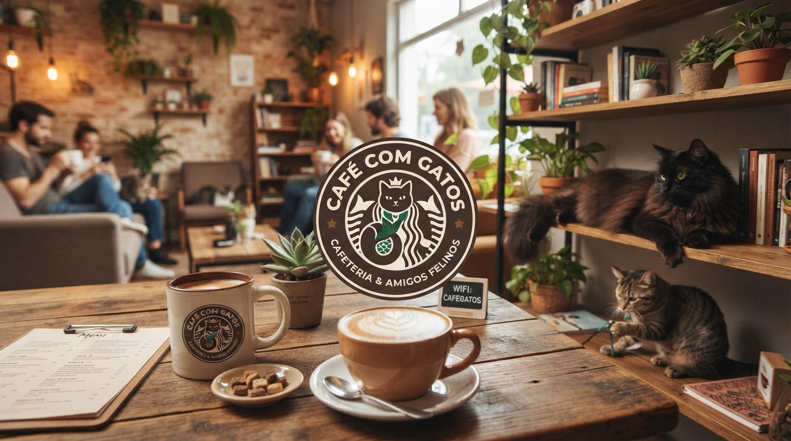

# Café com Gatos

Cafeteria fictícia com gatos, feita como mostruário de front-end. É HTML, CSS e
JavaScript puros: sem framework, sem build, sem nenhuma dependência para rodar.
Basta abrir o `index.html`.



## As páginas

São cinco, todas estáticas, montadas sobre a mesma base visual:

- **Início** (`index.html`) — hero com slideshow de fundo e cards de acesso rápido.
- **Nosso Cardápio** (`pages/nossoCardapio.html`) — produtos separados por categoria
  e um carrinho que funciona de verdade.
- **Nossos Gatinhos** (`pages/nossosGatinhos.html`) — quem mora na cafeteria e como
  eles são cuidados.
- **Adote** (`pages/adote.html`) — gatinhos disponíveis, filtro por idade e formulário
  de interesse.
- **Sobre Nós** (`pages/sobreNos.html`) — história, propósito e valores.

## Como rodar

Não precisa instalar nada. Abrir `index.html` no navegador já funciona, porque todos
os caminhos são relativos. Se quiser simular a hospedagem de verdade:

```bash
python -m http.server 8000
```

E acessar `http://localhost:8000`. No VS Code dá para usar a extensão Live Server: a
porta 5501 já está fixada no `.vscode/settings.json`.

## Como o código está organizado

O `css/style.css` guarda a base e os componentes. Quatro páginas puxam um CSS extra
quando têm blocos próprios; a de gatinhos nunca passou de algumas regras e ficou no
arquivo principal. No JavaScript vale a mesma ideia: cada página puxa o script que precisa,
quando precisa. Gatinhos e Sobre abrem sem nenhum.

O `.editorconfig` fixa o que os arquivos já seguem: UTF-8 sem BOM, fim de linha CRLF e
quatro espaços de indentação.

```text
.
├── .editorconfig
├── .vscode/            # porta do Live Server
├── index.html
├── assets/
│   ├── icons/
│   └── images/
├── css/
│   ├── style.css       # variaveis, base, header, footer, componentes e gatinhos
│   ├── home.css
│   ├── cardapio.css
│   ├── adote.css
│   └── sobre-nos.css
├── js/
│   ├── home.js
│   ├── cardapio.js
│   └── adote.js
└── pages/
    ├── nossoCardapio.html
    ├── nossosGatinhos.html
    ├── adote.html
    └── sobreNos.html
```

### CSS

O que se repete entre páginas fica em variáveis no `:root` do `style.css`: as cores,
as fontes e a escala de espaçamento. O que é usado uma vez só vai direto na regra,
que é onde alguém vai ler aquilo. Se a paleta mudar, muda em um lugar só. Os outros
arquivos não redefinem `:root` nem componentes globais, então uma página não consegue
"quebrar" a aparência da outra sem querer.

### HTML

Todas as páginas repetem a mesma estrutura: skip link, header com a mesma navegação,
um único `<h1>`, `<main id="conteudo">` e o mesmo rodapé. A página atual é marcada com
`aria-current="page"` em vez de uma classe extra, e todo caminho é relativo — o site
funciona igual em `usuario.github.io/repositorio/`.

### JavaScript

Scripts curtos e sem dependência. Os três rodam dentro de uma IIFE com `'use strict'`: no
topo de um script clássico, `const` não vaza para o `window`, mas declaração de função vira
propriedade dele. Onde faz sentido uso delegação de eventos (um
listener na lista em vez de um por botão). O carrinho guarda uma cópia do produto com a
quantidade em um array e redesenha a partir dele. Adicionar abre o painel flutuante, mas
sem fundo escurecido e sem puxar o foco: dá para seguir no cardápio, e um clique fora fecha.

### Acessibilidade

Skip link em todas as páginas, foco visível, rótulos em todos os botões e contraste
conferido nos textos sobre foto. O slide do hero pausa no hover, no foco e quando a aba
sai de vista, e quem desligou animação no sistema não vê transição nem autoplay.

## O que é demonstração

O formulário de adoção não envia nada: valida os campos e mostra a confirmação, mas
nenhum dado sai do navegador. Ligar isso a um serviço real está na lista abaixo.

## Publicação no GitHub Pages

1. Suba o repositório para o GitHub.
2. Em **Settings → Pages**, escolha a branch principal e a pasta `/docs`.
3. O site fica em `https://<usuario>.github.io/<repositorio>/`.

## O que eu faria depois

- Ligar o formulário de adoção a um serviço de envio (Formspree ou similar).
- Trocar as fotos por versões otimizadas com `srcset` e WebP — juntas elas somam uns
  16 MB, o que pesa mais do que todo o resto do site.
- Criar uma página 404 própria.

## Licença

Apache 2.0. Consulte [LICENSE](../LICENSE).
